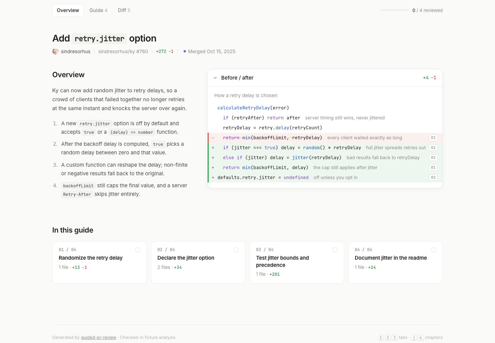

# guided-pr-review

Turn a GitHub pull request into an interactive guided walkthrough:

- **Overview** explains the change, shows an annotated before/after, and adds a
  readable Pele data-flow diagram when it materially helps.
- **Guide** groups files into reviewable chapters with focused diffs.
- **Diff** preserves the complete file-by-file view.
- **Canvas tools** let you ask Copilot about a line and post GitHub review
  comments without leaving the walkthrough.

The output is one self-contained HTML file that works offline.



## Install

Add `a-stack` as a native Copilot marketplace, then install the plugin:

```bash
copilot plugin marketplace add heyitsaamir/a-stack
copilot plugin install guided-pr-review@a-stack
```

Start a fresh Copilot session, then ask:

> Use `/guided-pr-review` to walk me through
> `https://github.com/owner/repo/pull/123`.

Update later with:

```bash
copilot plugin update guided-pr-review
```

## What it needs

- Node.js 18.17 or newer
- GitHub CLI 2.48.0 or newer, authenticated with `gh auth login` or `GH_TOKEN`

Copilot installations use the active Copilot model and do not need a separate
AI key.

## Standalone CLI

From this directory:

```bash
node scripts/cli.mjs owner/repo#123 --out ./reviews --open
node scripts/cli.mjs owner/repo#123 --no-ai
```

Run `node scripts/cli.mjs --help` for all options. Standalone AI analysis can
use `AI_GATEWAY_API_KEY`; without it, the CLI falls back to a heuristic guide.

## Development

```bash
npm run check
npm run sample
```

The checked-in examples live in [`samples/`](samples/).

## Credits

Originally created by [@chasemc67](https://github.com/chasemc67) in
[`chasemc67/guided-pr-review`](https://github.com/chasemc67/guided-pr-review).
This maintained version adds native GitHub Copilot plugin packaging, Copilot
analysis, the interactive canvas, and supplemental Pele data-flow diagrams.

The guided-review presentation was inspired by
[Capy's Guided Reviews](https://capy.ai/changelog/0.4.4). Data-flow diagrams
are rendered by [Pele](https://pele.run/).

## License

MIT. See [`LICENSE`](LICENSE). The original copyright and attribution are
preserved.

